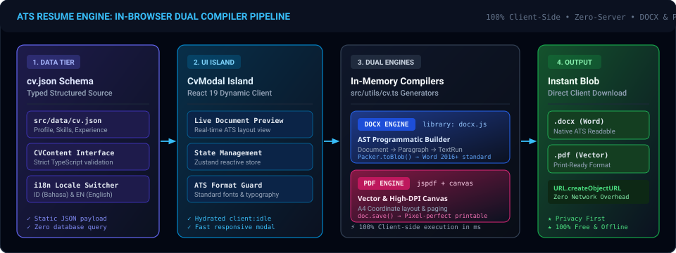
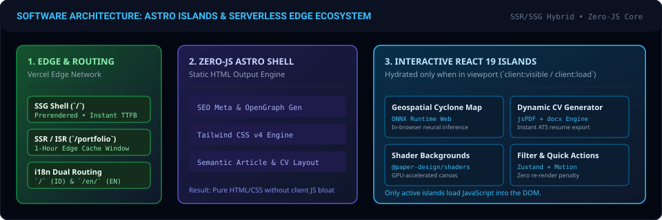

<div align="center">



<br/>
<br/>

# ✨ Modern Developer Portfolio & Showcase

**A blazing-fast, aesthetic, and production-ready developer portfolio web application.**  
Engineered with **Astro 7**, **React 19**, **TypeScript**, and **Tailwind CSS v4**.

<br/>

[](https://ikhwann.my.id)
[](https://astro.build)
[](https://react.dev)
[](https://www.typescriptlang.org)
[](https://tailwindcss.com)
[](https://vercel.com)
[](LICENSE)

<br/>

**[ 🇺🇸 English ](README.md)** • **[ 🇮🇩 Bahasa Indonesia ](README.id.md)**

<br/>

[🚀 Live Demo](https://ikhwann.my.id) • [✨ Key Features](#-key-features) • [🏗️ System Architecture](#️-system-architecture) • [🛠️ Tech Stack](#️-tech-stack) • [⚡ Quick Start](#-quick-start) • [🎨 Customization Guide](#-customization-guide)

</div>

---

## 🌟 Overview

Welcome to the official repository for **Ikhwan Ramadhan's Developer Portfolio** ([ikhwann.my.id](https://ikhwann.my.id)).

Unlike standard static portfolios or heavy Single Page Applications (SPAs), this project is engineered using **Astro's Island Architecture** combined with **React 19**. It delivers the speed of pre-rendered static HTML with the power of selective client-side interactivity, achieving near-perfect Lighthouse scores while offering advanced client-side features like an **in-browser ATS resume generator (PDF & DOCX)**, **instant case-study modals**, **multilingual localization (i18n)**, and **smooth physics-based inertial scrolling**.

### ⚡ Highlights at a Glance
- 🚀 **Sub-300ms First Contentful Paint (FCP)** via zero-JS static HTML shell.
- ⚛️ **Partial Hydration**: React 19 JavaScript is shipped *only* to interactive components.
- 📄 **In-Browser ATS Document Engine**: Export resumes to both **PDF** and native **DOCX** client-side.
- 🎨 **Next-Gen Design System**: Tailwind CSS v4 with dark mode and buttery-smooth animations.
- 🌐 **First-Class i18n**: Built-in Indonesian (`/`) and English (`/en/`) localized routing.
- 🎛️ **100% Data-Driven**: Easily customizable via central JSON schemas (`portfolio.json` & `cv.json`).

---

## ✨ Key Features

### ⚡ Zero-JS Core & Astro Island Architecture
Pages are pre-rendered statically at build time. Text content, layout scaffolding, and SEO tags ship as pristine, zero-JavaScript HTML. JavaScript is only downloaded and executed when a visitor interacts with an island.

### 📄 In-Browser Dual-Engine ATS CV Generator
Visitors and recruiters can preview and export professional resumes on the fly directly in the browser:
- **PDF Export**: Pixel-perfect printable document rendering powered by `jspdf` and `html2canvas`.
- **Native DOCX Export**: Clean, semantically structured Microsoft Word documents compiled with `docx` for maximum ATS scanner compatibility.

<div align="center">
  
</div>

### 💼 Interactive Project Showcase & Deep-Dive Modals
- Real-time keyword search and reactive tag filtering.
- Rich modal case studies complete with problem statements, architectural solutions, tech badges, live demo previews, and GitHub repository links.
- Backed by a lightweight **Zustand store** for instant, jitter-free state transitions.

### 📝 Markdown Case-Study Viewer
Integrated Markdown viewer with **GitHub Flavored Markdown (GFM)** support (`react-markdown` + `remark-gfm`), formatted code blocks, and styled tables.

### 🎨 Tailwind CSS v4 & Modern Micro-Interactions
- Built using the latest **Tailwind CSS v4** engine with CSS-first configuration.
- Fluid micro-animations powered by **Motion (Framer Motion v12)**.
- Buttery smooth inertial scrolling powered by **Lenis**.
- Subtle canvas confetti celebratory triggers (`canvas-confetti`).

### 🌓 Zero-Flicker Dark / Light Mode
Persistent theme switching synchronized with system color preferences (`prefers-color-scheme`) and `localStorage`, rendered without Flash of Unstyled Content (FOUC).

### 🌐 Native Multilingual Support (i18n)
- Clean, SEO-friendly dual-path routing:
  - Indonesian: `/`, `/portfolio`, `/about`, `/contact`
  - English: `/en/`, `/en/portfolio`, `/en/about`, `/en/contact`
- Fully typed localization dictionaries with seamless fallbacks.

### 🔍 Comprehensive SEO & Open Graph Automation
- Complete **JSON-LD Structured Data** (`Person`, `WebSite`, `WebPage`, `BreadcrumbList`).
- Dynamic Open Graph image generation (`scripts/generate-og.mjs`).
- Auto-generated `sitemap-index.xml` via `@astrojs/sitemap`.

---

## 🏗️ System Architecture

The project follows a modern three-tier frontend architecture designed for optimal performance and maintainability:

<div align="center">
  
</div>

### 1. Edge & Routing Tier (Vercel Edge Network)
- Static files distributed globally on Vercel CDN for minimal Time to First Byte (TTFB).
- URL-level language routing (`/` vs `/en/`) with proper canonical and hreflang tags.

### 2. Static Shell Tier (Astro SSG Engine)
- Pre-renders static layouts, semantic typography, navigation shells, and metadata schemas.
- Delivers instantaneous rendering with zero client-side JavaScript execution.

### 3. Interactive Island Tier (React 19)
- Islands hydrate independently (`client:load` or `client:visible`):
  - `ProjectShowcase`: Filter, search, and reactive portfolio catalog.
  - `CvModal`: Dynamic in-browser PDF & DOCX resume compiler.
  - `MarkdownModal`: Project technical documentation viewer.
  - `Navbar & ThemeToggle`: Theme switcher and responsive navigation drawer.

---

## 🛠️ Tech Stack

<table>
  <thead>
    <tr>
      <th width="24%">Layer</th>
      <th>Technologies &amp; Libraries</th>
    </tr>
  </thead>
  <tbody>
    <tr>
      <td><strong>Core Framework</strong></td>
      <td>
        <a href="https://astro.build"></a>
        <a href="https://react.dev"></a>
        <a href="https://www.typescriptlang.org"></a>
      </td>
    </tr>
    <tr>
      <td><strong>Styling &amp; UI</strong></td>
      <td>
        <a href="https://tailwindcss.com"></a>
        <a href="https://lucide.dev"></a>
      </td>
    </tr>
    <tr>
      <td><strong>Animation &amp; Scroll</strong></td>
      <td>
        
        
        
      </td>
    </tr>
    <tr>
      <td><strong>Document Engines</strong></td>
      <td>
        
        
        
      </td>
    </tr>
    <tr>
      <td><strong>State &amp; Content</strong></td>
      <td>
        
        
        
      </td>
    </tr>
    <tr>
      <td><strong>Build &amp; Bundling</strong></td>
      <td>
        <a href="https://vitejs.dev"></a>
        
        
      </td>
    </tr>
    <tr>
      <td><strong>Deployment &amp; Edge</strong></td>
      <td>
        <a href="https://vercel.com"></a>
        
      </td>
    </tr>
  </tbody>
</table>

---

## 📂 Project Structure

This project follows a clean, domain-driven structure adhering to strict `kebab-case` naming conventions:

```text
.
├── public/
│   ├── assets/                # SVG banners & system architecture diagrams
│   ├── certificates/          # Credential copies and certification images
│   ├── CV/                    # Static CV files
│   ├── projects/              # Optimized WebP thumbnails for portfolio case studies
│   └── og.png                 # Default social share card
├── scripts/
│   └── generate-og.mjs        # Automated script to generate Open Graph image
├── src/
│   ├── components/            # Reusable UI components & modal islands
│   │   ├── layout/            # Navbar, Footer, and Canvas effects
│   │   └── modal/             # CV Modal, Markdown Editor, and Detail dialogs
│   ├── data/
│   │   ├── locales/           # i18n translation dictionaries (id/ and en/)
│   │   ├── cv.json            # Centralized resume, education, and career data
│   │   └── portfolio.json     # Comprehensive portfolio project data
│   ├── design/                # Design tokens and styling constants
│   ├── features/              # Feature modules grouped by domain
│   │   ├── hero/              # Hero banner, availability badge, CTA buttons
│   │   ├── portfolio/         # Project grid, category filter, case study modals
│   │   ├── about/             # Bio, timeline, skills, and background
│   │   └── contact/           # Contact form and social communication channels
│   ├── hooks/                 # Custom React hooks (useProjects, useModal, useTheme)
│   ├── layouts/
│   │   └── site.astro         # Master HTML shell, SEO meta, JSON-LD Schema
│   ├── pages/
│   │   ├── index.astro        # Home page (Indonesian, SSG)
│   │   ├── about.astro        # About Me page
│   │   ├── portfolio.astro    # Portfolio showcase page
│   │   ├── contact.astro      # Contact page
│   │   ├── project/[slug].astro      # Static dynamic route for case studies
│   │   ├── certificate/[id].astro    # Static dynamic route for certificates
│   │   └── en/                # English localized routes (/en/...)
│   ├── store/                 # Lightweight global state with Zustand
│   ├── styles/
│   │   └── global.css         # Tailwind CSS v4 directives & keyframe styles
│   ├── utils/                 # Formatting utilities, date helpers, and i18n
│   ├── app.tsx                # Client application root & island orchestrator
│   └── types.ts               # Centralized TypeScript interface definitions
├── astro.config.mjs           # Astro configuration & React plugin
├── package.json               # Project dependencies and NPM scripts
├── tsconfig.json              # TypeScript compiler configuration
└── README.md                  # Project documentation
```

---

## ⚡ Quick Start

### Prerequisites
- **Node.js**: `v20.0.0` or higher
- **Package Manager**: `npm`, `pnpm`, or `bun`

### Installation Steps

1. **Clone the Repository**:
   ```bash
   git clone https://github.com/IngsR/Portofolio.git
   cd Portofolio
   ```

2. **Install Dependencies**:
   ```bash
   npm install
   ```

3. **Configure Environment Variables (Optional)**:
   ```bash
   cp .env.example .env
   ```

4. **Start Local Development Server**:
   ```bash
   npm run dev
   ```
   Open [http://localhost:3000](http://localhost:3000) in your browser.

5. **Build for Production**:
   ```bash
   npm run build
   ```
   The optimized production bundle will be generated in the `dist/` directory.

---

## 🎛️ Customization Guide

You can easily adapt this repository to showcase your own projects and experience:

### 1. Update Profile & Resume Data (`src/data/cv.json`)
Replace the biographical information, work experience, education, skills, and contact links with your own details. The in-browser ATS CV generator automatically reads from this file to compile both PDF and DOCX documents.

### 2. Add Your Projects (`src/data/portfolio.json`)
Add your projects under the `projects` array. Each entry supports:
- `title`, `slug`, `category`, `description`
- `tags` (technology stack badges)
- `links` (`demo`, `github`, `docs`)
- `markdown` (detailed case study content rendered inside the modal)
- `translations.en` (English translations for seamless bilingual display)

### 3. Customize Domain & SEO Metadata
- In [`astro.config.mjs`](file:///d:/Project/Portofolio/astro.config.mjs): update `site: "https://yourdomain.com"`
- In [`src/layouts/site.astro`](file:///d:/Project/Portofolio/src/layouts/site.astro): update default titles, metadata, and JSON-LD schema info.

### 4. Update Images & Assets
Place your project screenshots in `public/projects/` and your certification images in `public/certificates/`.

---

## 📜 Available Scripts

| Script | Command | Description |
| :--- | :--- | :--- |
| `dev` | `npm run dev` | Runs the Astro local development server on `port 3000` with hot-reload |
| `build` | `npm run build` | Compiles optimized static production assets to `dist/` |
| `preview` | `npm run preview` | Locally serves and previews the built production bundle |
| `lint` | `npm run lint` | Runs TypeScript type checking across all files (`tsc --noEmit`) |
| `format` | `npm run format` | Automatically formats the entire codebase using Prettier |
| `format:check` | `npm run format:check` | Verifies code formatting compliance without modifying files |
| `og:generate` | `npm run og:generate` | Automatically generates the Open Graph social preview banner |
| `clean` | `npm run clean` | Cleans up the `dist/` build directory and build caches |

---

## 🚀 Deployment

The project is pre-configured for instant zero-configuration deployment to **Vercel**:

[](https://vercel.com/new/clone?repository-url=https%3A%2F%2Fgithub.com%2FIngsR%2FPortofolio)

### Manual Vercel Deployment
1. Import this repository into your [Vercel Dashboard](https://vercel.com).
2. Framework Preset: **Astro** (auto-detected).
3. Build Command: `astro build` (default).
4. Output Directory: `dist` (default).
5. Deploy! Your portfolio will be served via Vercel's global Edge Network.

---

## 🤝 Contributing

Contributions, issues, and feature requests are welcome!  
Feel free to check out the [issues page](https://github.com/IngsR/Portofolio/issues).

If you found this project helpful or inspiring, please consider giving it a **⭐️ Star**!

---

## 👨‍💻 Author

**Ikhwan Ramadhan**

- 🌐 Website: [https://ikhwann.my.id](https://ikhwann.my.id)
- 🐙 GitHub: [@IngsR](https://github.com/IngsR)
- 💼 LinkedIn: [Ikhwan Ramadhan](https://www.linkedin.com/in/ikhwn-rdn)
- ✉️ Email: [ikhwn.rdn@gmail.com](mailto:ikhwn.rdn@gmail.com)

---

## 📄 License

This project is licensed under the [MIT License](LICENSE).  
Feel free to use this template to build your own developer portfolio!

<div align="center">
  <br/>
  <sub>Crafted with passion & modern web technologies by <strong>Ikhwan Ramadhan</strong> • © 2026</sub>
</div>
