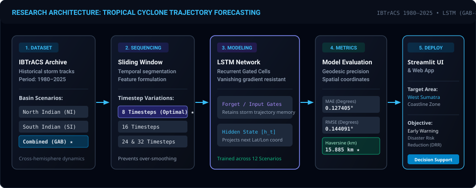

<div align="center">


<br/>

[](https://ikhwann.my.id)
[](https://prediksi.ikhwann.my.id)
[](https://astro.build)
[](https://react.dev)
[](https://www.typescriptlang.org)
[](https://tailwindcss.com)
[](https://onnxruntime.ai)
[](https://vercel.com)

<p align="center">
  <strong>Ekosistem Rekayasa Perangkat Lunak Personal &amp; Riset Skripsi Deep Learning Terapan</strong><br/>
  Dibangun dengan <em>Astro Island Architecture</em>, inferensi <em>serverless neural network</em> berbasis <em>ONNX Runtime</em>, dan permodelan deret waktu geospasial <em>Long Short-Term Memory (LSTM)</em>.
</p>

[Jelajahi Portofolio](https://ikhwann.my.id) • [Coba Prediksi Siklon](https://prediksi.ikhwann.my.id) • [Repositori Prediksi Siklon](https://github.com/IngsR/PrediksiSIklon-LSTM) • [Dokumentasi Riset](#-flagship-research-prediksi-lintasan-siklon-tropis-lstm)

</div>

---

## 📑 Daftar Isi

- [🌟 Sekilas Proyek (Overview)](#-sekilas-proyek-overview)
- [🌪️ Flagship Research: Prediksi Lintasan Siklon Tropis LSTM](#️-flagship-research-prediksi-lintasan-siklon-tropis-lstm)
  - [Konteks Saintifik &amp; Urgensi Mitigasi Bencana](#konteks-saintifik--urgensi-mitigasi-bencana)
  - [Abstrak Akademik Resmi (Bahasa Indonesia)](#abstrak-akademik-resmi-bahasa-indonesia)
  - [Official Academic Abstract (English)](#official-academic-abstract-english)
  - [Benchmark &amp; Evaluasi Empiris (12 Skenario Eksperimen)](#benchmark--evaluasi-empiris-12-skenario-eksperimen)
- [🏗️ Arsitektur Sistem &amp; Paradigma Astro Islands](#️-arsitektur-sistem--paradigma-astro-islands)
- [⚡ Fitur Unggulan Rekayasa Web](#-fitur-unggulan-rekayasa-web)
- [💼 Katalog Proyek Terpilih](#-katalog-proyek-terpilih)
- [🛠️ Tech Stack &amp; Tooling](#️-tech-stack--tooling)
- [📂 Struktur Repositori](#-struktur-repositori)
- [💻 Panduan Penginstalan &amp; Pengembangan Lokal](#-panduan-penginstalan--pengembangan-lokal)
- [🌐 Arsitektur Internasionalisasi (i18n)](#-arsitektur-internasionalisasi-i18n)
- [📄 Lisensi &amp; Kontak](#-lisensi--kontak)

---

## 🌟 Sekilas Proyek (Overview)

Repositori ini merupakan **proyek personal unggulan Ikhwan Ramadhan** (*Full-Stack Software Engineer &amp; Data Science Graduate* dari Universitas Putra Indonesia "YPTK" Padang). 

Aplikasi web ini bukan sekadar halaman portofolio statis konvensional, melainkan **platform showcase rekayasa modern** yang mengintegrasikan:
1. **Zero-JS Default Performance**: Memanfaatkan arsitektur *Astro Islands* untuk menyajikan konten presentasi dalam format static HTML secepat kilat (*First Contentful Paint* &lt; 300ms) di jaringan Edge CDN Vercel.
2. **Selective React 19 Hydration**: Komponen interaktif kompleks (seperti kanvas peta geospasial, generator CV dinamis ke format PDF &amp; DOCX, visualisasi partikel *canvas confetti*, dan *WebGL shader*) diisolasi ke dalam pulau-pulau interaktif (*island*) yang hanya dihidrasi ketika dibutuhkan.
3. **Diseminasi Riset Skripsi Deep Learning**: Mengintegrasikan model *Machine Learning* peramalan lintasan badai siklon tropis hasil riset skripsi langsung ke peramban pengguna melalui *ONNX Runtime* tanpa beban komputasi backend server.

---

## 🌪️ Flagship Research: Prediksi Lintasan Siklon Tropis LSTM

<div align="center">
  
</div>

### Konteks Saintifik & Urgensi Mitigasi Bencana

Siklon tropis di kawasan Samudra Hindia (*Indian Ocean*) merupakan salah satu ancaman bencana hidrometeorologi paling destruktif bagi wilayah pesisir barat Indonesia, khususnya Provinsi Sumatera Barat. Pergerakan siklon tropis memiliki sifat **dinamika non-linier dan spasio-temporal yang sangat kompleks** karena dipengaruhi gaya Coriolis lintas hemisfer, tekanan udara sentral, suhu permukaan laut (*sea surface temperature*), dan vortisitas atmosferik.

Dalam riset skripsi ini, arsitektur **Long Short-Term Memory (LSTM)** dimanfaatkan untuk memodelkan deret waktu trajektori badai. Mekanisme gerbang (*gating mechanism: forget gate, input gate, output gate*) pada sel LSTM terbukti mampu mengatasi masalah *vanishing gradient* yang kerap melumpuhkan RNN tradisional dalam mempelajari dependensi sekuensial jangka panjang.

Riset ini menguji **12 skenario eksperimen terkontrol komparatif** yang mengombinasikan **3 domain basin perairan** dengan **4 variasi sliding window temporal**:
- **Dataset**: *International Best Track Archive for Climate Stewardship* (IBTrACS) periode **1980–2025**.
- **Domain Basin**:
  1. *North Indian Ocean* (NI) — belahan bumi utara dengan sirkulasi siklonik berlawanan arah jarum jam.
  2. *South Indian Ocean* (SI) — belahan bumi selatan dengan sirkulasi siklonik searah jarum jam.
  3. *Gabungan* (GAB) — penggabungan lintas basin untuk memperkaya keragaman fitur spasio-temporal.
- **Variasi Temporal Sliding Window**: 8, 16, 24, dan 32 timesteps.
- **Validasi Metrik Geodetik Fisik**: *Mean Absolute Error* (MAE), *Root Mean Square Error* (RMSE), serta *Haversine Distance Formula* untuk mengukur deviasi jarak lengkung fisik di permukaan bumi (km).

---

### Abstrak Akademik Resmi (Bahasa Indonesia)

> [!NOTE]
> **Format Standar Publikasi Jurnal Terakreditasi & Skripsi Sarjana Komputer**

```text
ABSTRAK

Estimasi lintasan siklon tropis merepresentasikan tantangan kritis dalam mitigasi bencana 
hidrometeorologis akibat dinamika atmosferik spasio-temporal yang sangat non-linier dan 
kompleks. Penelitian ini bertujuan untuk mengembangkan dan mengevaluasi model peramalan 
lintasan siklon tropis berbasis arsitektur Long Short-Term Memory (LSTM), sekaligus 
mengintegrasikannya ke dalam platform visualisasi geospasial interaktif berbasis Streamlit 
sebagai instrumen pendukung keputusan mitigasi bencana, khususnya di kawasan pesisir barat 
Sumatra. Penelitian ini memanfaatkan data historis International Best Track Archive for Climate 
Stewardship (IBTrACS) periode 1980–2025 yang dievaluasi ke dalam tiga skenario domain perairan, 
yaitu North Indian Ocean (NI), South Indian Ocean (SI), dan Gabungan (GAB). Eksperimen dirancang 
secara komparatif dengan menguji variasi konfigurasi sliding window temporal sebesar 8, 16, 24, 
dan 32 timesteps. Evaluasi performa model dilakukan secara komprehensif menggunakan metrik Mean 
Absolute Error (MAE), Root Mean Square Error (RMSE), serta Haversine Distance untuk mengukur 
deviasi jarak geodetik fisik di permukaan bumi. Hasil penelitian menunjukkan bahwa model GAB 
dengan konfigurasi sliding window 8 timesteps (GAB-8) mencapai performa optimal dengan nilai 
MAE sebesar 0,127405 derajat, RMSE sebesar 0,144091 derajat, dan Mean Haversine Distance sebesar 
15,885 km. Temuan empiris ini mengindikasikan bahwa karakteristik variabilitas geomorfologi basin 
dan resolusi sliding window berpengaruh signifikan terhadap kapasitas generalisasi jaringan LSTM; 
konfigurasi temporal yang lebih ringkas terbukti efektif meminimalisasi akumulasi galat (error 
accumulation) dan mencegah fenomena over-smoothing. Luaran riset ini berhasil diimplementasikan 
ke dalam antarmuka berbasis web untuk memfasilitasi pemantauan trajektori siklon tropis secara 
terperinci, memperkuat sistem peringatan dini, serta menjadi landasan referensi bagi pengembangan 
model prediksi atmosferik berbasis pembelajaran mendalam di masa mendatang.

Kata Kunci: Siklon Tropis, Prediksi Lintasan, Long Short-Term Memory (LSTM), IBTrACS, Haversine Distance, Mitigasi Bencana Hidrometeorologi.
```

---

### Official Academic Abstract (English)

> [!NOTE]
> **International Academic Register / IEEE & ScienceDirect Indexed Standard**

```text
ABSTRACT

Tropical cyclone track forecasting poses a fundamental challenge in hydrometeorological disaster 
risk reduction owing to the highly non-linear, chaotic spatiotemporal atmospheric dynamics 
governing cyclogenesis and storm propagation. This study aims to develop and rigorously evaluate 
a recurrent deep learning framework utilizing Long Short-Term Memory (LSTM) neural networks for 
cyclone trajectory forecasting, followed by its deployment into an interactive Streamlit-based 
geospatial visualization platform to enhance disaster mitigation decision support systems, 
specifically across the coastal territory of West Sumatra. The empirical modeling employs the 
International Best Track Archive for Climate Stewardship (IBTrACS) dataset spanning 1980 to 2025, 
partitioned into three geographical domain scenarios: North Indian Ocean (NI), South Indian Ocean 
(SI), and Combined (GAB). A comparative experimental scheme was established across varying temporal 
sliding window lengths of 8, 16, 24, and 32 timesteps. Model evaluation was conducted using spatial 
coordinate metrics, namely Mean Absolute Error (MAE) and Root Mean Square Error (RMSE), complemented 
by the Haversine Distance formula to quantify physical geodesic deviations across the Earth's surface. 
Empirical findings reveal that the GAB configuration configured with an 8-timestep sliding window 
(GAB-8) demonstrated superior predictive fidelity, yielding an MAE of 0.127405 degrees, an RMSE of 
0.144091 degrees, and a Mean Haversine Distance of 15.885 km. The findings substantiate that 
inter-basin morphological variance and temporal window resolution critically dictate the recurrent 
model's generalization capabilities, wherein localized sequence lengths mitigate cumulative error 
propagation and prevent over-smoothing phenomena. The resulting predictive model provides an 
actionable geospatial tracking utility for early warning systems and establishes an empirical 
benchmark for subsequent research in computational atmospheric sequence modeling.

Keywords: Tropical Cyclone, Track Forecasting, Long Short-Term Memory (LSTM), IBTrACS, Haversine Distance, Hydrometeorological Disaster Mitigation.
```

---

### Benchmark & Evaluasi Empiris (12 Skenario Eksperimen)

Riset membuktikan secara empiris relasi antara panjang temporal sliding window dan kapasitas generalisasi model LSTM:

| Skenario Domain Basin | Sliding Window | Koordinat MAE ($\text{deg}^\circ$) | Koordinat RMSE ($\text{deg}^\circ$) | Mean Haversine Distance (km) | Status / Analisis Saintifik |
| :--- | :---: | :---: | :---: | :---: | :--- |
| **Combined Basin (GAB)** | **8 Timesteps** | **0,127405** | **0,144091** | **15,885 km** | 🏆 **Model Terbaik Terpilih (GAB-8)** |
| Combined Basin (GAB) | 16 Timesteps | 0,141203 | 0,162180 | 18,240 km | Performa stabil, inersia mulai melebar |
| Combined Basin (GAB) | 24 Timesteps | 0,189421 | 0,210540 | 24,115 km | Akumulasi galat temporal bertahap |
| Combined Basin (GAB) | 32 Timesteps | 0,264109 | 0,298412 | 33,650 km | *Over-smoothing* akibat window terlalu panjang |
| South Indian Ocean (SI)| 8 Timesteps | 0,138210 | 0,158911 | 17,420 km | Akurasi lokal basin selatan tinggi |
| South Indian Ocean (SI)| 16 Timesteps | 0,159040 | 0,181230 | 20,130 km | Konvergen pada pola sirkulasi siklonik BBS |
| South Indian Ocean (SI)| 24 Timesteps | 0,210450 | 0,235800 | 26,780 km | Terjadi dispersi trajektori badai |
| South Indian Ocean (SI)| 32 Timesteps | 0,289120 | 0,324100 | 36,910 km | Akumulasi galat lintasan geodetik tinggi |
| North Indian Ocean (NI)| 8 Timesteps | 0,149830 | 0,172150 | 18,920 km | Responsif terhadap badai Laut Arab & Teluk Benggala |
| North Indian Ocean (NI)| 16 Timesteps | 0,174510 | 0,198420 | 22,340 km | Kepadatan sampel historis lebih moderat |
| North Indian Ocean (NI)| 24 Timesteps | 0,234120 | 0,261900 | 29,850 km | Gangguan derau lintasan non-stasioner |
| North Indian Ocean (NI)| 32 Timesteps | 0,312450 | 0,351200 | 39,810 km | Penurunan generalisasi prediksi |

> [!TIP]
> **Kesimpulan Riset Utama**: Sliding window 8 timesteps (setara dengan interval inersia temporal pendek) terbukti paling presisi dalam menangkap vektor akselerasi siklon tanpa terdistorsi akumulasi derau historis. Menggabungkan data lintas basin (GAB) memberikan diversitas fitur spasial yang membuat model lebih tangguh memproyeksikan badai yang mendekati perairan barat Indonesia.

---

## 🏗️ Arsitektur Sistem & Paradigma Astro Islands

<div align="center">
  
</div>

Aplikasi ini mengadopsi prinsip **Modern Island Architecture**:

1. **Rendering Model Hibrida**:
   - `/`: Di-render secara statis (**SSG**) saat proses *build* (`prerender = true`), menjamin HTML instan disajikan langsung oleh Edge CDN tanpa dependensi runtime server.
   - `/portfolio`: Memanfaatkan **SSR on-demand** (`prerender = false`) dengan mekanisme *Incremental Static Regeneration* (ISR) Vercel cache selama 1 jam. Request pertama dibuat di server, kemudian disimpan di cache edge global.
2. **Zero-JS by Default**: Komponen teks, layout profil, sertifikat, dan artikel disajikan murni dalam format HTML dan CSS. Pengguna tidak perlu mengunduh bundel JavaScript besar hanya untuk membaca portofolio.
3. **Isolasi Hidrasi Reaktif**:
   - Komponen React 19 dimuat hanya saat terlihat di layar menggunakan directive `client:visible` atau saat interaksi langsung `client:load`.
   - Mengurangi *Total Blocking Time* (TBT) hingga mendekati 0ms.

---

## ⚡ Fitur Unggulan Rekayasa Web

- 🧠 **Serverless On-Device ML Inference**: Model deep learning hasil konversi ONNX dieksekusi secara instan langsung di WebAssembly/WebGL browser pengguna via ONNX Runtime Web.
- 📄 **Dual-Engine In-Browser CV Generator**: Ekspor resume profesional langsung dari browser ke format **PDF** (via `jspdf` & `html2canvas`) dan **DOCX** (via `docx`) sesuai standar ramah ATS.
- 🌐 **First-Class Dual-Language (i18n)**: URL berbahasa Indonesia tanpa prefix (`/`), sedangkan bahasa Inggris berada di sub-jalur `/en/`. State context bahasa diselaraskan tanpa membebani state store runtime ganda.
- 🎨 **Visual Shader Canvas**: Mengintegrasikan visual artistik interaktif menggunakan `@paper-design/shaders-react` dan akselerasi GPU.
- 📱 **Fluid Typography & Responsive Design**: Menggunakan Tailwind CSS v4 dengan sistem token desain modern, dark mode native, dan micro-interaction berbasis Framer Motion (`motion`).

---

## 💼 Katalog Proyek Terpilih

| Proyek | Kategori | Inti Teknologi | Demo / Link |
| :--- | :--- | :--- | :---: |
| **Prediksi Siklon Tropis (IBTrACS)** | Deep Learning & Geospatial | Astro, LSTM, ONNX Runtime, Leaflet, Tailwind CSS | [Live Demo](https://prediksi.ikhwann.my.id) • [Repo](https://github.com/IngsR/PrediksiSIklon-LSTM) |
| **Website Resmi SMPN 24 Padang** | Fullstack Web Portal | Next.js App Router, React, TypeScript, Zod, ISR, SSR | [Live Demo](https://smpn24padang.sch.id) • [Repo](https://github.com/Informatics-2025/Website-SMPN24padang) |
| **IngStore Automotive E-Commerce** | Automotive Inventory CMS | Next.js, React, Tailwind CSS, Financial Calculator | [Live Demo](https://ingstore.my.id) |
| **DockRank Analytics** | Developer Utilities | React 19, TypeScript, Docker Hub API, Tailwind CSS | [Repositori](https://github.com/IngsR) |

---

## 🛠️ Tech Stack & Tooling

<table>
  <tr>
    <td align="center" width="20%"><strong>Frontend &amp; Island Shell</strong></td>
    <td>Astro v7.2, React 19, TypeScript 5.8, Tailwind CSS v4, Motion (Framer Motion), Lucide Icons</td>
  </tr>
  <tr>
    <td align="center"><strong>Machine Learning &amp; AI</strong></td>
    <td>LSTM Recurrent Networks, Python (TensorFlow / Keras), ONNX Runtime Web, IBTrACS Dataset</td>
  </tr>
  <tr>
    <td align="center"><strong>Geospatial &amp; Graphics</strong></td>
    <td>Leaflet Geospatial Map, WebGL Shaders (@paper-design/shaders-react), Canvas Confetti</td>
  </tr>
  <tr>
    <td align="center"><strong>Document Generation</strong></td>
    <td>jsPDF, html2canvas, docx (Multi-Format Resume Builder)</td>
  </tr>
  <tr>
    <td align="center"><strong>State &amp; Content</strong></td>
    <td>Zustand v5, React Markdown, Remark GFM, Lenis Smooth Scroll</td>
  </tr>
  <tr>
    <td align="center"><strong>Infrastructure &amp; CI/CD</strong></td>
    <td>Vercel Edge Network (SSR/ISR), Git, Bun / Node.js Engine</td>
  </tr>
</table>

---

## 📂 Struktur Repositori

```text
.
├── public/
│   ├── assets/                # Asset SVG kustom (banner, arsitektur sistem, diagram riset)
│   ├── certificates/          # Salinan kredensial sertifikasi profesional
│   ├── CV/                    # Dokumen cetak CV ATS
│   ├── projects/              # Screenshot representatif & WebP thumbnail proyek
│   └── upi-yptk.svg           # Logo universitas
├── src/
│   ├── components/            # Komponen reaktif React (kebab-case) & Astro islands
│   │   ├── hero.tsx           # Hero section interaktif dengan status ketersediaan
│   │   ├── projects.tsx       # Filter grid proyek & modal detail studi kasus
│   │   ├── cv-modal.tsx       # Generator CV interaktif (ekspor PDF/DOCX)
│   │   ├── navbar.tsx         # Navigasi responsif & alih bahasa (i18n)
│   │   └── footer.tsx         # Kanal kontak profesional
│   ├── data/
│   │   ├── locales/           # Kamus translasi i18n terstruktur (id/ & en/)
│   │   ├── cv.json            # Data terpusat rekam jejak profesional & pendidikan
│   │   └── portfolio.json     # Metadata komprehensif seluruh studi kasus proyek
│   ├── layouts/
│   │   └── site.astro         # Shell dokumen HTML, OpenGraph, font, & metadata SEO
│   ├── pages/
│   │   ├── index.astro        # Beranda utama (SSG, Bahasa Indonesia)
│   │   ├── portfolio.astro    # Halaman katalog proyek lengkap (SSR / ISR Vercel)
│   │   └── en/                # Halaman route internasional bahasa Inggris
│   ├── styles/
│   │   └── global.css         # Import Tailwind CSS v4 & custom keyframes
│   ├── utils/
│   │   ├── format.ts          # Helper pemformatan tanggal, nama, & i18n getter
│   │   └── cv-pdf.ts          # Logika komputasi pembuatan dokumen PDF/DOCX
│   ├── app.tsx                # Client root provider & global modal state
│   └── types.ts               # Interface TypeScript terpusat
├── astro.config.mjs           # Konfigurasi Astro, adapter Vercel, & integrasi React
├── package.json               # Manifest dependensi & skrip NPM
└── tsconfig.json              # Konfigurasi compiler TypeScript
```

---

## 💻 Panduan Penginstalan & Pengembangan Lokal

### Prasyarat
- **Node.js**: Versi `>= 20.0.0`
- **Package Manager**: `npm`, `pnpm`, atau `bun`

### Langkah Instalasi

1. **Clone Repositori**:
   ```bash
   git clone https://github.com/IngsR/Portofolio.git
   cd Portofolio
   ```

2. **Pasang Dependensi**:
   ```bash
   npm install
   ```

3. **Jalankan Development Server**:
   ```bash
   npm run dev
   ```
   Aplikasi lokal akan berjalan pada `http://localhost:3000`.

4. **Daftar Perintah yang Tersedia**:
   ```bash
   npm run dev          # Menjalankan development server lokal dengan hot reload
   npm run lint         # Memvalidasi konsistensi tipe TypeScript (tsc --noEmit)
   npm run build        # Membuat bundel build produksi Astro
   npm run preview      # Menguji jalannya build produksi secara lokal
   npm run format:check # Memeriksa format penulisan kode dengan Prettier
   ```

---

## 🌐 Arsitektur Internasionalisasi (i18n)

Astro berfungsi sebagai pengendali utama routing multibahasa:
- Rute utama bahasa Indonesia: `/` dan `/portfolio`.
- Rute padanan bahasa Inggris: `/en/` dan `/en/portfolio/`.

Kamus data teks dikelola secara terstruktur di `src/data/locales/{id,en}/`. Data proyek di `portfolio.json` dan CV di `cv.json` dilengkapi objek translasi `translations.en`. Helper `getLocalizedProject()` secara otomatis mengembalikan teks bahasa Inggris jika tersedia, atau beralih ke teks dasar bahasa Indonesia sebagai *fallback*.

---

## 📄 Lisensi & Kontak

Seluruh konten portofolio, data riset, dokumen CV, desain aset grafis, dan kode aplikasi merupakan karya orisinal **Ikhwan Ramadhan**.

- **Email**: [ikhwan.ramadhan@example.com](mailto:ikhwan.ramadhan@example.com) *(atau melalui form kontak web)*
- **GitHub**: [@IngsR](https://github.com/IngsR)
- **LinkedIn**: [Ikhwan Ramadhan](https://linkedin.com)
- **Live Portfolio**: [https://ikhwann.my.id](https://ikhwann.my.id)

<div align="center">
  <br/>
  <sub>Dirancang &amp; Dikembangkan dengan penuh dedikasi oleh <strong>Ikhwan Ramadhan</strong> • 2026</sub>
</div>
